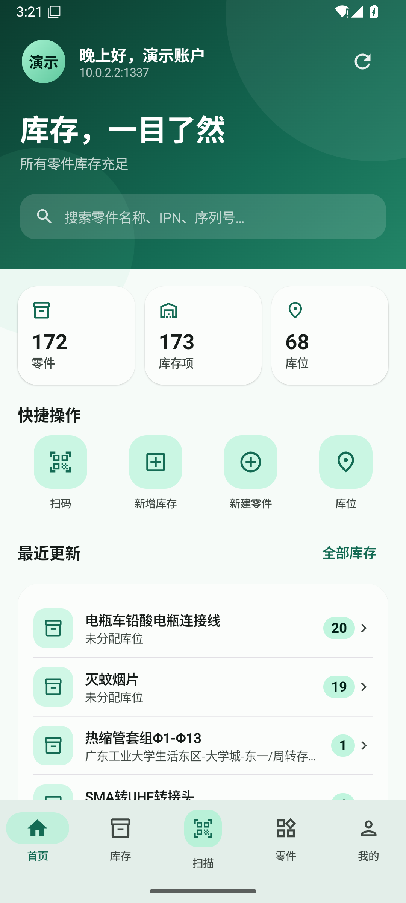
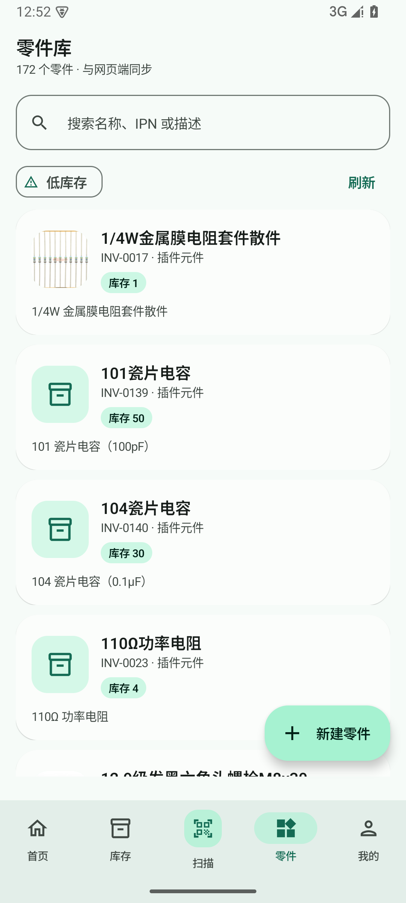
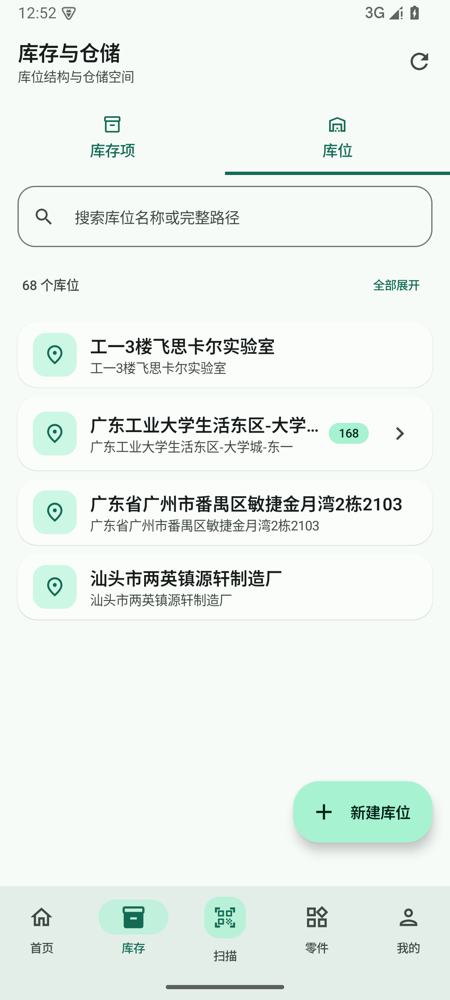
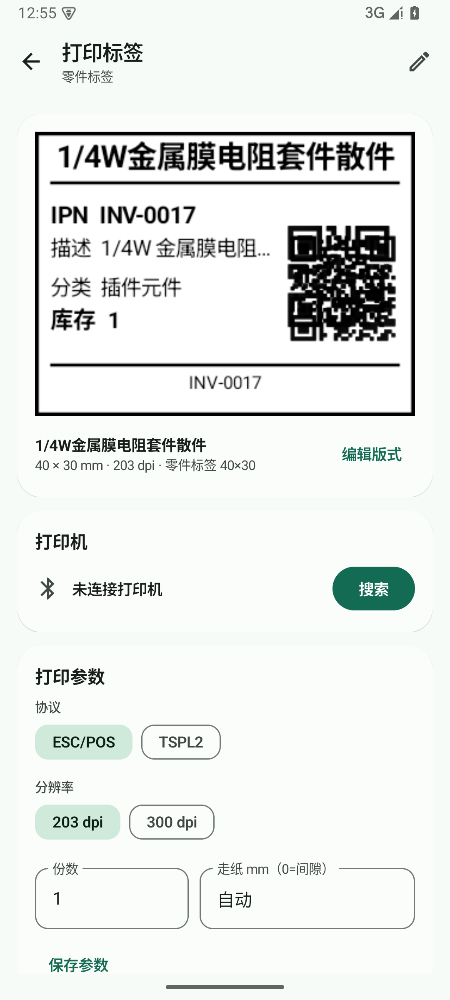
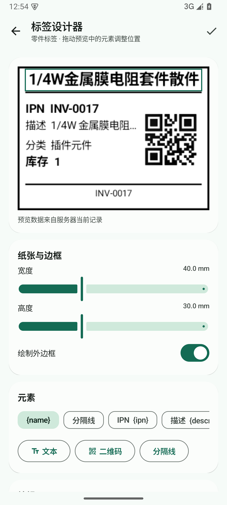
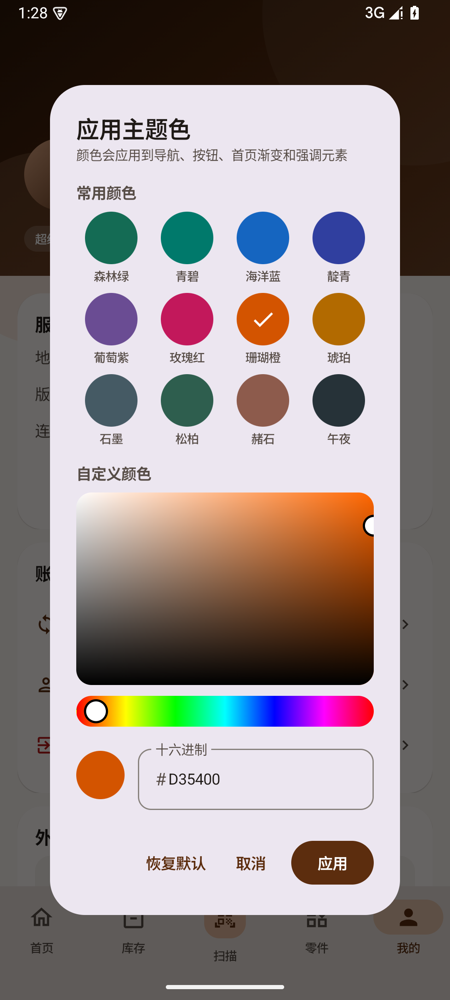
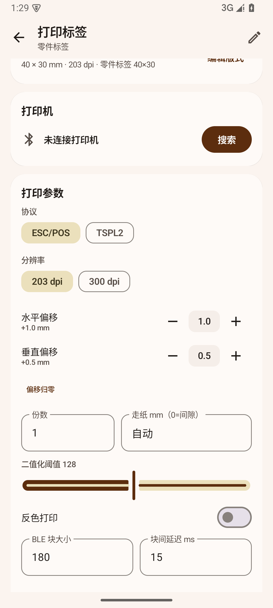
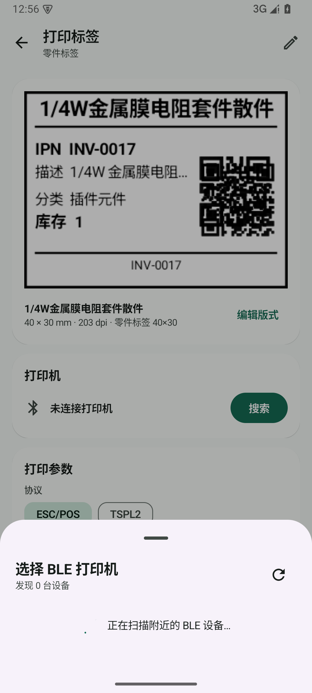
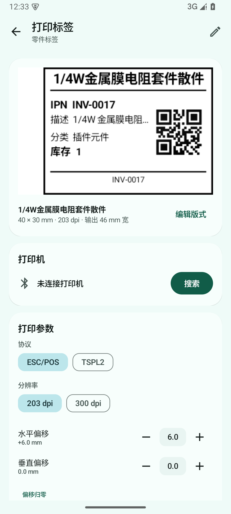

# InvenTree CustomApp

[](https://github.com/BI7KHI/inventree-customapp/releases/latest)
[](https://developer.android.com)
[](https://inventree.org)
[](LICENSE)

面向 InvenTree 的原生 Android 客户端，使用 Kotlin、Jetpack Compose、Material 3 实现。直接调用 InvenTree REST API，库存、库位、零件、账户数据与网页端实时一致。

## 下载

[**⬇️ 下载最新 Release**](https://github.com/BI7KHI/inventree-customapp/releases/latest)

| 项目 | 值 |
| --- | --- |
| 当前版本 | **1.2.1** |
| 文件 | `InvenTree-Mobile-1.2.1.apk` |
| 包名 | `xyz.bi7khi.inventree.mobile` |
| 系统要求 | Android 8.0+（API 26），targetSdk 35 |
| 服务器 | 支持任意 InvenTree 1.5.x（API 530+），地址可在 App 内配置 |
| APK SHA-256 | `55daf7e465269463e45ecf5d77b6b9e5b2c8638c767a31c9ce203b11b9352840` |

> GitHub Release 附件是签名 APK；`dist/` 是本地构建产物，不纳入 Git。

| 首页 | 零件 |
| --- | --- |
|  |  |

| 多功能库位树 | 标签打印 |
| --- | --- |
|  |  |

| 标签设计器 | 主题颜色 |
| --- | --- |
|  |  |

| 偏移校准 | BLE 扫描 |
| --- | --- |
|  |  |

## 1.2.1 修复

### 水平偏移 +6mm 时右侧/二维码被裁切

**原因**：旧实现把内容在固定 40mm 宽画布内向右平移，右侧超出画布的部分被裁掉；二维码位于标签右侧，因此会被截断一半。

**修复**：

- 水平正偏移改为“左侧补白”：位图宽度随偏移增加，整张标签右移，右侧内容不再被裁切；
- +6mm 时输出宽度为 46mm，预览中二维码完整；
- 预览宽高比跟随实际输出位图；
- 负偏移仍向左移动；垂直偏移仍在标签高度内移动。

> 注意：左补白后的输出宽度大于标签纸宽度，打印机可打印宽度必须能覆盖（多数 203dpi 标签机打印头宽于 40mm）。若打印机物理打印头只有 40mm，硬件本身仍会裁切，需要改用打印机自身的原点设置或缩小版式。



## 1.2.0 新增

### BLE 水平/垂直偏移校准

- 打印参数新增水平偏移、垂直偏移，范围 -15mm – +15mm，0.5mm 步进；
- 正值向右/向下，负值向左/向上；
- 水平正偏移通过左侧补白实现，不会裁切右侧二维码；负偏移向左移动；
- 垂直偏移仍以标签边界裁切；
- 预览立即显示偏移效果；
- 与协议、DPI、份数、走纸、阈值、反色、BLE 块大小一起保存到本机，重启和下次打印继续生效；
- “偏移归零”可一键恢复。

### 主题颜色

“我的 → 外观 → 主题颜色”：

- 12 个常用色块：森林绿、青碧、海洋蓝、靛青、葡萄紫、玫瑰红、珊瑚橙、琥珀、石墨、松柏、赭石、午夜；
- 自定义 HSV 取色：色相条、饱和度/明度二维面板、十六进制输入；
- 应用后立即刷新导航、按钮、首页/登录渐变、强调元素和状态色；
- 主题色使用 DataStore 持久化，重启后保留；
- 支持“恢复默认”森林绿。

## 1.1.0 新增

### 零件图片修复

InvenTree 的 `/media/` 由 nginx `auth_request` 保护。网页端依靠登录 Cookie 显示图片，原生 App 使用 API Token，之前的图片请求没有携带 Token，所以上传过图片的零件也显示空白。

现在所有零件缩略图请求都会：

- 携带 `Authorization: Token ...`；
- 优先加载缩略图，失败后回退原图；
- 过滤 InvenTree 的 `blank_image` 占位图；
- 全部失败时显示明确的零件占位图标，而不是白色空块。

图片会走 Coil 的磁盘缓存，列表滚动时不会反复下载。

### 库位层级折叠

库存 → 库位页改为真正的层级树：

- 默认只显示顶级库位，所有子库位默认收纳；
- 点击行末箭头展开/收起；
- 支持“全部展开 / 全部收起”；
- 搜索时自动切换为匹配结果平铺列表；
- 库位选择器（转移、新建库存、默认库位、父库位）同样默认折叠，可逐级展开。

### BLE 标签打印

把本地 `ble-label-printer` 插件的核心能力移植为 Android 原生实现：

- BLE 扫描、设备列表、连接、服务发现；
- 自动选择可写 GATT 特征；
- 协商 MTU，按 MTU 自动限制写入块大小；
- 优先使用有应答写入，提供流控；
- ESC/POS 位图指令（`GS v 0`）与 TSPL2（`SIZE` / `GAP` / `BITMAP` / `PRINT`）；
- 203 / 300 dpi，份数、走纸、二值化阈值、反色参数；
- 测试走纸；
- 打印进度与失败提示。

BLE 打印页的布局对齐网页端 40×30mm 标签：

- 标题栏、信息区、二维码、底栏、外边框；
- 库存：名称 / IPN / 批号 / 数量 / 序列号 / 二维码；
- 零件：名称 / IPN / 描述 / 分类 / 库存 / 二维码；
- 库位：名称 / 描述 / 上级 / 库存项数 / 二维码。

### 原生标签设计器

- 拖动预览中的文本、二维码、分隔线调整位置；
- 编辑文本内容，支持 `{name}`、`{ipn}`、`{quantity}` 等变量；
- 编辑二维码内容（`{qr}`、`{url}`、`{code}` 或固定文本）；
- 字号、粗体、对齐、二维码尺寸、元素显隐；
- 添加/删除文本、二维码、分隔线；
- 纸张宽高 25–70mm × 15–60mm、外边框开关；
- 每个模板（库存/零件/库位）独立保存到本机；
- 打印页右上角和“编辑版式”可直接进入设计器，保存返回后立即刷新预览。

## 已有功能

- 服务器选择，兼容 HTTPS、内网 HTTP 和子路径部署；
- 账户密码登录（换取 API Token）+ API Token 登录（SSO/2FA）；
- Token 使用 Android Keystore AES-GCM 加密，密码不落盘；
- 401 自动登出，重启自动登录；
- 首页统计、低库存、最近更新、快捷操作；
- 库存列表/搜索/库位筛选/分页；
- 入库、出库、库存转移、盘点、库存属性编辑、删除；
- 新建库存项、默认库位、批次、序列号、包装；
- 库位详情、层级浏览、新建/编辑/删除；
- 零件列表、详情、新建/编辑、分类、库存阈值、类型开关；
- CameraX + ML Kit 扫码，支持 QR/Data Matrix/Code 128 等；
- 服务器扫码结果匹配库存/零件/库位；
- 生成并显示库存二维码。

## 安装

从 [Releases](https://github.com/BI7KHI/inventree-customapp/releases/latest) 下载 APK，传到手机后允许“安装未知应用”安装；或使用 adb：

```bash
adb install -r InvenTree-Mobile-1.2.1.apk
```

首次启动保留默认服务器，点击“连接服务器”，使用网页端同一账户登录。启用 SSO/2FA 的账户请切换到“API Token”，在网页端账户设置中生成 Token 后粘贴。

升级时请保留同一签名；1.2.1 可直接覆盖 1.2.0 / 1.1.0 / 1.0.0。

### 打印标签

1. 打开库存项、零件或库位详情；
2. 点击顶部打印机图标；
3. 点击“搜索”，授权附近设备权限，选择 BLE 打印机；
4. 连接成功后点击“打印标签”；
5. 如需改版，点“编辑版式”进入设计器，保存后返回打印页。

## 本机验证

环境：

- Android Emulator：Android 15 / API 35 / medium_phone
- 本机 InvenTree：1.5.2 / API 530，`http://10.0.2.2:1337`
- HTTPS 生产服务器：TLS 探测通过

已验证：

- 账户登录、Token 持久化、401 自动退出；
- 已上传图片的零件缩略图正常显示（带 Token 请求 `/media/part_images/L14.thumbnail.png` 返回 200）；
- 库位页默认只显示顶级库位，展开后显示 14 个子库位；
- 标签打印预览：40×30mm、QR、标题/信息/底栏与网页模板一致；
- 标签设计器选择二维码、修改二维码内容、保存、返回打印页后预览立即更新；
- BLE 扫描权限申请、扫描界面、0 设备空状态；
- 水平/垂直偏移 +1.0/+0.5mm 保存后重启仍保持；
- 主题切换到珊瑚橙后首页/导航/按钮即时变色，重启保留；
- 标签位图、偏移渲染与 ESC/POS/TSPL2 指令流的 5 项仪器测试通过；
- JVM 单元测试 19 项通过；
- Android Lint 0 error。

**未验证**：由于本机没有 BLE 热敏打印机，真实 GATT 写入与纸张走纸尚未做真机验证；编码器、位图渲染、BLE 扫描/权限流程已测试。真机首次打印建议先用“测试走纸”，再打印 1 张。

## 构建

```bash
git clone https://github.com/BI7KHI/inventree-customapp.git
cd inventree-customapp
echo 'sdk.dir=/path/to/android-sdk' > local.properties

./gradlew :app:assembleDebug
./gradlew :app:testDebugUnitTest
./gradlew :app:connectedDebugAndroidTest   # 需要模拟器/真机
./gradlew :app:assembleRelease
```

Release 签名使用本地 keystore，不进入仓库；只构建 Debug 或自行配置 `keystore.properties`。

签名密钥不进入 Git；`keystore.properties` 指向本地 keystore。升级安装时需使用同一签名。

## 目录

```text
app/src/main/java/xyz/bi7khi/inventree/mobile/
  data/api/          REST API、DTO、Token、媒体鉴权
  data/local/        DataStore + Keystore 会话
  data/label/        标签模型、渲染器、BLE 传输、ESC/POS/TSPL2
  ui/screens/        登录、首页、库存、库位、零件、扫码、打印、设计器
  ui/navigation/     路由与底栏
  ui/components/     图片、选择器、二维码、通用组件
docs/                截图、BLE 与标签变量说明
dist/                本地构建 APK（Git 忽略）
```

## 文档

- [BLE 打印与传输](docs/BLE_PRINTING.md)
- [标签变量列表](docs/LABEL_VARIABLES.md)
- [变更记录](CHANGELOG.md)
- [1.2.1 Release Notes](docs/RELEASE_1.2.1.md)

## 已知边界

- 当前原生界面聚焦库存、仓储、零件、扫码、账户和 BLE 标签；采购单、销售单、BOM、报表打印走网页端。
- BLE 打印支持 ESC/POS 与 TSPL2 位图，不支持打印机厂商私有协议或蓝牙 SPP（经典蓝牙串口）。
- 标签编辑器当前只支持文本、二维码、分隔线；不支持图片/Logo、条码一维码和自由旋转。
- 无离线写队列；弱网时显示错误和重试。
- 为兼容内网自建服务器允许 HTTP，正式环境建议 HTTPS。

## 安全

- 密码只做一次 Basic → Token 交换，不保存；
- Token 经 Android Keystore AES-GCM 加密，不进入云备份；
- 不记录 `Authorization` 头；
- 所有写操作走 InvenTree 官方 API，权限与审计由服务器执行；
- 图片请求只向当前 InvenTree 服务器附加 Token。

## License

本项目使用 [MIT License](LICENSE)。
